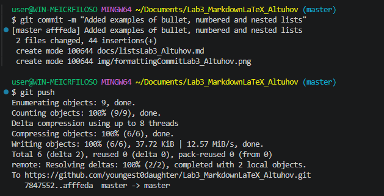

# Лабораторная работа №3

Целью данной лабораторной работы является глубокое изучение облегченного языка разметки Markdown, а также математических формул с помощью синтаксиса LaTeX.

## Содержание
1. [Структура проекта](#структура-проекта)
2. [Примеры текстовых элементов](#примеры-текстовых-элементов)
3. [Математические выражения LaTeX](#математические-выражения-latex)
4. [Статус выполнения](#статус-выполнения)

---

## Структура проекта:
* `README.md` — главный файл описания
* `docs/` — папка со справочными файлами по шагам
    * `headersLab3_Altuhov.md`
    * `separatorsLab3_Altuhov.md`
    * `formattingLab3_Altuhov.md`
    * `listsLab3_Altuhov.md`
    * Всё писать не буду
* `img/` — каталог скриншотов выполнения
* `latex/` — файлы с математическими формулами

## Примеры текстовых элементов

### Цитата дня
> Работа не волк. Работа это ворк. А волк это ходить.

### Таблица Git-команд

| Действие | Синтаксис | Описание |
| :--- | :---: | ---: |
| Фиксация | `git commit` | Создание слепка |
| Отправка | `git push` | Передача данных |
| Статус | `git status` | Проверка индекса |

### Код программы
```csharp
Console.WriteLine("Hello, World!");
```

### Скриншоты выполненной работы
Пример выполненного пуша в репозиторий:
---

---

Всю необходимую информацию о синтаксисе можно найти в [Инструкциях к Markdown](https://markdownguide.org)[^1].

## Математические выражения LaTeX

Пример использования строчной формулы площади:
 $S = \pi r^2$.

Блочная формула суммы арифметической прогрессии:

$$
\sum_{i=1}^n i = \frac{n(n+1)}{2}
$$

## Статус выполнения
- [x] Шаги 1-4: Инициализация и привязка к GitHub
- [x] Шаги 5-12: Разметка элементов Markdown
- [x] Шаг 13: Оформление формул LaTeX
- [x] Самостоятельное оформление README

> [!CAUTION]
> улыбнитесь

---
[^1]: Сноска: Markdown поддерживается GitHub с автоматическим рендерингом стилей.
